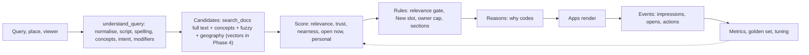
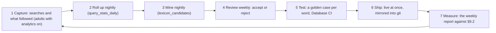

# Discovery algorithms: search, suggestions, recommendations

Everything that decides **what a person sees and in what order**: search results, suggestions while typing, For you, Explore,
"more like this", cart add-ons, people you may know, jobs, the feed and the driver ring. The trust score that says how good a
page is stays in [RECOMMENDATION_ALGORITHM.md](RECOMMENDATION_ALGORITHM.md); this plan uses it as one input and does not repeat it.

Status: plan, 2026-11-18. Phase 0 is built on branch `feat/discovery-phase0` (2026-11-19) and not yet applied to the live project:
`search_quality2.sql`, `discovery_log.sql`, the golden set and the logging suite (§10). Every weight below is a starting value to check
against the golden query set (§9) and to tune on real data later, not a settled number. How the system keeps learning after that is §13.

## Summary

- **Today** there are 15 separate SQL functions, each ordering things its own way. Nothing logs what people search for or open,
  so nothing can be measured. Search lets junk in ("taxi" returns a USB-C cable) and misses everyday words ("tution", "website",
  "kaapi", anything typed or spoken in Kannada or Hindi script). For you and Explore only work through syncs, so a newcomer
  sees nothing there.
- **The data is tiny**: 16 real people and 11 real pages, every vote an ↑. No weight can be learned from that. So the plan
  builds deterministic, explainable algorithms, a privacy-safe event log and a golden query set first, and learns weights only once the
  traffic gates in §10 are met.
- **One pipeline for every surface**: understand the query → find candidates → score with one short, visible formula →
  apply fairness rules → explain → log.
- **Order of work**: Phase 0 (1–2 weeks) stops the junk, fixes the misses through the synonym table, and starts measuring.
  Phase 1 (3–5 weeks) builds the search core and suggestions. Phase 2 (4–6 weeks) adds the trust score and the recommendations.
  Phases 3 and 4 wait for enough data, not for a date.
- **A learning loop that never stops** (§13): every night the server rolls up searches and mines candidate words from what people
  rephrased or never found; every week a person accepts or rejects them, each with a golden-set case; every month and quarter the numbers
  decide what to test and whether the next phase may start. What learns is always reviewed, versioned and reversible.
- **Seven decisions for you** are in §11.

---

## 1. What exists (audit, 2026-11-18)

### 1.1 Every place an order is decided

| Surface | Live function (file that wins in `apply_all.sh`) | Finds | Orders by |
|---|---|---|---|
| Search: Home "Search all", Services tiles, search screen | `search_listings` (`search_quality.sql`; it is defined 7 times) | LIVE pages within ≤ 50 km or shipping India-wide. Text through a `simple` tsvector, title trigram, `ILIKE` on category, type and owner name, and products by substring or `word_similarity ≥ 0.6`; 72 synonyms | online ↓, text score ↓, (↑ − ↓) ↓, distance |
| "More <category> nearby" on a page | the app: `search('', 5 km, same kind)`, filtered to the same category, first 4 | same | browse order |
| iOS "Top rated near you" | `search_listings('', BUSINESS + SKILL)` | same | browse order, so it is "online first", not top rated |
| Home box: people | `search_people` | name `ILIKE`, exact Bucks ID | ID match, synced, mutual syncs, name |
| Home box and search: places | `search_places` + Mapbox/OSM | pages, areas, user places, 156,756 India Post localities | source group, distance |
| Feed tab | `feed_synced` | me, synced people, synced pages | newest first |
| Explore | `explore` | posts I may see, last 180 days | has a synced ↑ → number of synced ↑ → newest |
| Explore › Places, Products | `for_you_named` | pages and products my synced people ↑ | count ↓, latest ↓ |
| Recommended map | `map_places` | posts tagged to places, ≤ 3 per author per place | Wilson lower bound (95 %) with one pseudo-vote each way |
| People you may know | `suggest_people` | discoverable people, minors' rules | mutual syncs ↓, 2 km distance step, a stable hash |
| Jobs near me | `jobs_near` | open jobs within 15 km | distance, newest |
| Driver ring | `drivers_to_ring` + `notify` | online, same vehicle, fresh heartbeat, in radius | straight-line distance, ≤ 20, all rung at once |
| A driver's request list | `open_tasks_near` | tasks they can claim | distance |
| Products inside a shop | the app (`StoreCatalog`) | the shop's items | Featured, % recommended then votes, price, name |
| Category picker for a new page | `category_suggestions` | categories in use | uses ↓ |
| Never called | `suggest_listings` (Android and iOS wrappers exist) | pages friends recommend | dead code |

### 1.2 What the live data looks like

- **People:** 34, of which 16 are real and 18 are the demo world. Real people are in Kodagu (Ponnampet, Gonikoppal: 7),
  Bengaluru (2), Kallukoottam (1) and Thrissur (1); 5 have no area.
- **Live pages:** 52. The 11 real ones (8 shops, 3 pros) are all in Pune; the 41 demo pages are in Gonikoppal, Whitefield and
  Kallukoottam. **No real page is near a real person.**
- **Signals:** 474 products, 55 posts (25 by real people), 303 post votes (24 by real people), 42 reviews, 85 in-person QR
  recommendations. Every vote and every review is ↑, and no review is tied to an order or a trip. There are 0 product ratings
  and 0 person votes. 36 of 52 pages have no votes at all, and the best has net +4.
- **Transactions:** 5 orders, 13 trips and deliveries, 15 jobs, 0 applications.
- **Graph:** 306 accepted syncs (27 between real people) and 1,026 page syncs, most of them demo.
- **Speed:** search takes 117 ms for "basmati rice" and 58 ms to browse, at 52 pages. It runs sub-queries over every product
  of every page in the radius, so the cost grows with pages × products. A city-sized catalogue would likely take seconds.
- **Logging:** the server logs no queries. On Android the only search event is people search with a result count. The
  listing search screen logs nothing on either app.

What this means: at this size any "learned" weight is noise. What can be built now is the plumbing (logs, tests, an index)
and rules that are right by construction.

### 1.3 Search, tested on the live database

The probes were picked to find weak spots, so read them as a list of failure types, not as a success rate.
They ran at Gonikoppal and Whitefield with a 50 km radius; milk, medicine, cake and ac repair ran at Whitefield only.

| Query | What came back | What should come back |
|---|---|---|
| taxi | "USB-C Cable" (the synonym taxi → cab matches the "Cab" inside "Cable"); a "Scabiosa" bouquet 740 km away | the ride card, and no shop |
| milk | a "Milky White" sculpture 747 km away | groceries and dairies nearby |
| medicine | MedPlus Care, then an "Abstract Cat Figurine — Medium" 747 km away | MedPlus Care only |
| cake | the bakery, then a "Cake Display Stand" 747 km away | bakeries |
| ac repair | "Carpenter, furniture repair" | "No AC mechanic nearby", then appliance repair |
| home stay | "Yoga trainer, home sessions" | nothing, or homestays |
| tution (the common Indian spelling) | nothing | the maths tutor in range (3.2 km from Whitefield) |
| website | nothing | "Full-stack web developer" (in range) |
| mobile, laptop | nothing | Gadget Hub, electronics (in range) |
| kaapi | nothing | coffee, sold by two pages in range at each place |
| cheap grocery | nothing | the grocery, cheapest first |
| ಹಾಲು (milk), दूध (milk), ಕಾಫಿ (coffee) | nothing | as for milk and coffee. Voice search in Kannada and Hindi produces exactly these scripts |
| plumbers, plumbr, electrecian, bijli wala | the right page | this works (`search_quality.sql`) |

Of the 28 runs of the second probe set, 12 found nothing although a fitting page was in range, 4 returned junk, 11 had genuinely
nothing to find and showed a bare "no results", and 1 was right.

### 1.4 The problems, most important first

1. **Nothing is measured.** There are no query logs, no zero-result rate, no opens and no conversions, so no change can be proven.
2. **Junk gets in.** Substring matching on short words and loose fuzzy matching let in junk, and ranking cannot fix bad candidates.
3. **Everyday language is missed.** This covers spellings outside the list, concepts ("website" → developer, "mobile" → electronics,
   "doctor" → clinic), colloquial words ("kaapi"), modifiers ("cheap", "open now", "best") and sentences, because every word must match.
4. **Indian scripts return nothing**, even though the voice button produces them.
5. **Ranking is a chain of tie-breaks.** Online comes first, so an online page with a weak match beats an offline page with a
   perfect one. Next comes a text score that is a sum of three similarity measures, a decimal that almost never ties. As a result,
   trust and distance seldom count for a typed query. Shops that ship India-wide, 740 km away, mix into local results.
6. **Four formulas for "how good"**: net count (search), Wilson (map), raw counts (For you, Explore) and percentage (products).
   The trust score that should replace them (RECOMMENDATION_ALGORITHM Phase 1) is not built.
7. **Recommendations only travel through syncs.** For you and the top of Explore are empty for a newcomer. There is no "popular
   here", no "new nearby" and no "people who follow X also follow Y", although 1,026 page syncs exist.
8. **Explore ignores votes and place, and has no time decay or per-author cap.** A 170-day-old post with one synced ↑ outranks
   every fresh post.
9. **There are no real suggestions.** Typing shows people and places only: no recent searches, no "did you mean", no "popular near
   you", no "tell me when one joins".
10. **People you may know uses one signal** (mutual syncs), and a suggestion cannot be dismissed.
11. **Jobs have no matching**, although Pro profiles hold skills, job types, work radius and languages.
12. **Speed will not hold at city scale**, and search-as-you-type runs a full search on every pause.
13. **Unused inputs.** Interests chosen at sign-up are not stored in the cloud. The person's language is stored (`profiles.language`)
    but search ignores it.

---

## 2. Principles

1. **No hidden ranking.** Every list can say in one sentence why it is in this order. "How is this ranked?" shows the formula
   and the weights, which live in a table, not in code. This continues the lens promise and the AI plan's rule D10 ([docs/ai](ai/README.md)).
2. **No pay-to-rank, ever.** If sponsored slots ever exist they are labelled, kept apart and never touch a score (CCPA dark
   patterns guidelines).
3. **Relevance first, then proof, then nearness.** An unrelated popular shop never appears. Among relevant results, proof and
   nearness decide.
4. **Proof beats volume.** "How good" is the trust score of RECOMMENDATION_ALGORITHM.md and nothing else.
5. **New is not bad.** New pages get reserved slots, and too little evidence shows "New", never a low score.
6. **Personal only when visible and switchable.** Adults get a "Personalised" lens they can turn off. Under-18s, guests (if
   guest browsing ships) and anyone who turns it off get the same non-personalised order: DPDP s.9(3) forbids behavioural
   monitoring of children.
7. **Learn the weights, keep the formula.** When data allows, weights are fitted from logs, but the score stays a short linear sum
   that can be shown to people.
8. **One implementation for both apps.** Ranking lives in SQL. The apps render rows and reasons and send events, so parity
   comes by construction.
9. **Build on what is already there.** That means Postgres with pg_trgm, PostGIS and pg_cron (pgvector, unaccent and fuzzystrmatch
   can be switched on). No search cluster and no ML service until the gates in §10 are met.
10. **Indian languages are first-class.** This covers Latin-script Hinglish and Kanglish, native scripts, Indian English spellings and voice.
11. **Don't optimise for time spent.** Explore and For you are judged by what people do next (visit, order, book, sync, vote),
    never by watch time.

---

## 3. One pipeline for every surface



| Piece | What it is | Status |
|---|---|---|
| `concepts`, `concept_terms` | The taxonomy (concept → categories, service, related concepts) and a lexicon of terms in every language and script. It grows out of `search_lexicon` | Phase 1 |
| `search_lexicon`, `search_parse()` | Phase 0's lexicon: SAME words (spellings, plurals, translations), CONCEPT words (a need a category answers), GENERIC, FILLER and MODIFIER words, about 950 rows under 13 language tags, one reviewable line per language; it took over the 72 words of `search_synonyms`. `search_parse()` is the query reader that `understand_query()` grows out of | built (`search_quality2.sql`) |
| `search_vocab` | Words in use (categories, product names, titles, lexicon) with counts, for spelling correction and suggestions | new, rebuilt nightly |
| `understand_query()` | Text in, structure out (§4.1) | new |
| `search_docs` | One indexed row per page and per product group, with precomputed price, stock, hours and quality | new; trigger plus nightly rebuild |
| `subject_scores` | The trust score per page, product, post and person | specified in RECOMMENDATION_ALGORITHM Phase 1; built in Phase 2 here |
| `ranking_config` | Weights per surface, versioned, editable without an app release (like `service_rules`) | new |
| `search_v2`, `search_suggest`, `similar_listings`, `for_you_v2`, `explore_v2`, `suggest_people_v2`, `jobs_for_me` | The read functions; every row carries `why` codes | new. The old functions keep answering app builds already in people's hands, as `feed`/`feed_synced` do today |
| `discovery_queries`, `discovery_events`, `query_stats_daily`, `lexicon_candidates`, `wanted` | Logging (§8), the learning loop (§13) and demand capture | built in Phase 0 (`discovery_log.sql`), except `wanted` (Phase 1) |
| `supabase/tests/search_golden_scenarios.sql` | The golden query set and its scorecard, run by Database CI | built (about 215 cases) |

---

## 4. Search

### 4.1 Understanding the query: `understand_query(q, q_latin, lang) → jsonb`

1. **Normalise:** Unicode NFC, lower case, trim, collapse spaces, drop punctuation except `&` and `-`, at most 100 characters.
2. **Script:** detect Devanagari, Kannada, Tamil, Telugu, Malayalam and Latin from Unicode blocks. The lexicon stores native-script
   terms directly (ಹಾಲು → milk), so the common words need no transliteration. For names and unknown words the apps also send
   `q_latin`. On Android 10 and later that comes from ICU (`android.icu.text.Transliterator`, "Any-Latin; Latin-ASCII"); minSdk is 26,
   so Android 8 and 9 send only `q`. On iOS 17 it comes from `applyingTransform(.toLatin)` plus `.stripDiacritics`.
3. **Filler and modifiers:** drop filler ("near me", "nearby", "please", "chahiye", "beku", "venum"). Turn modifiers into
   structure: `open_now` (open now, abhi), `cheap` (cheap, sasta), `best` (best, accha), `delivery` (home delivery), `veg` and
   `non_veg`, `max_price` ("under 500", "500 ke andar").
4. **Spelling:** a word not found in `search_vocab` is replaced by the nearest frequent word, using trigram similarity plus
   `levenshtein_less_equal` (fuzzystrmatch). A distance of 1 is accepted for 4–6 letters and 2 for 7 or more. Words under 4 letters
   are never corrected. So "tution" becomes tuition and "electrecian" becomes electrician. The app shows
   "Showing tuition · Search instead for tution".
5. **Concepts:** the longest phrase is looked up first in `concept_terms`, in any language. For example: bijli wala → electrician;
   kaapi, ಕಾಫಿ → coffee; website → software developer, web designer; mobile → phone shop, phone repair; doctor → clinic;
   xerox → photocopy; medical shop → pharmacy; saloon → barber; PG → rental. Each concept knows its categories, its service and
   its neighbours (ac repair → AC mechanic; neighbours appliance repair, electrician).
6. **Intent:** the result is a spread of likelihood over RIDE, PRODUCT, PAGE, PLACE, PERSON, JOB and POST. It comes from the concept's type,
   the rules the apps already have (ride words, a 6-digit pincode, the Bucks ID pattern, "job", "vacancy", "hiring"), and later,
   if it graduates, the on-device intent model prototype (branch `feat/ondevice-intent`, on hold). Intent orders the sections of
   the results page and never hides a section that has hits.

```json
{ "tokens": ["tuition"], "corrected": {"tution": "tuition"}, "concepts": [{"key": "tutor", "w": 0.95}],
  "intent": {"PAGE": 0.8, "JOB": 0.1, "PRODUCT": 0.1}, "modifiers": {"near": true}, "script": "Latin" }
```

### 4.2 The index: `search_docs`

There is one row per page and one per product group (items sharing `item_product_key`). The weighted `simple` tsvector holds:
**A** the title or product name; **B** the category, the type label and the matched concepts' labels and terms in every language;
**C** product names (on the page row), item tags (`details.tags`) and service names; **D** the first 500 characters of the
description. Precomputed columns hold the lowest in-stock price, the stock flag, a photo flag, `hours` (open now is computed at
query time), the delivery radius, ships India-wide, online, quality and the amount of evidence (from `subject_scores`; until then
the Wilson score of §4.4), owner, created date and `is_demo`. Indexes: GIN on the tsvector, GIN trigram on titles and product names,
GiST on location. Row triggers on `listings` and `items` keep it fresh. A nightly pg_cron job rebuilds it, along with
`search_vocab` and the quality columns.

### 4.3 Finding candidates

Candidates are the union of the sources below, capped at 300 and always inside the radius. The radius comes from the service's
`service_rules.radius_m` or from the chip. Shops that ship India-wide form a separate pool.

1. **Full text:** OR over the corrected words and concept terms, so a sentence still finds things. The share of meaningful words
   matched is scored, not required.
2. **Concept:** pages whose category belongs to a matched concept, even with no word in common (milk → groceries and dairies).
3. **Fuzzy, only when 1 and 2 give fewer than 5:** trigram similarity ≥ 0.45 on titles and product names, for words of 5 letters or more.

The rule that kills the junk: **match whole words, never inside a word** ("cab" ≠ "Cable", "milk" ≠ "Milky"). Prefix matching is
for suggestions (§5), not results.

### 4.4 Ranking v1

| Feature (0–1) | Definition |
|---|---|
| relevance `r` | best field × match type × √coverage. Field: category or concept exact 1.0, title phrase 0.95, title all words 0.85, product all words 0.85, tags 0.7, category only through a concept 0.7, description 0.45. Match type: exact 1.0, synonym or concept 0.9, spelling-corrected 0.85, fuzzy only 0.6. When the query has a confident concept and the page's category is outside it (a "Cake Display Stand" at a home decor shop), × 0.6 |
| quality `q` | the trust score from `subject_scores`. Until it exists: the Wilson lower bound of RECOMMENDATION_ALGORITHM §3.3 on today's ↑/↓ (z = 1.28, prior m = 0.7, k = 3). A page with no votes scores 0.35, one ↑ 0.46, four ↑ 0.64 |
| nearness `n` | `1 / (1 + (d / d0)²)`, where d0 is half the service radius (Food 2.5 km, Grocery 1.5 km, Gigs 2.5 km, Properties 5 km). A page at d0 counts half as near as one next door. When the query wants delivery and the page delivers to me, at least 0.8 |
| available `a` | 1 open now (from `hours`), online (pros, drivers) or in stock; 0.5 unknown; 0 closed |
| personal `p` | adults with the lens on: 0.6 × min(1, synced recommenders / 3) + 0.4 × "I've ordered or booked here"; otherwise 0 |
| price fit | only with "cheap" or a price cap: 1 − the price's percentile among the candidates |

```
typed query:  score = 0.50·r + 0.20·q + 0.15·n + 0.10·a + 0.05·p
browse:       score = 0.40·q + 0.30·n + 0.20·a + 0.10·p
modifiers:    near me → n +0.10 (taken from r) · best → q +0.10 · cheap → price fit 0.15 (taken from q) · open now → filter a = 1
gate:         r < 0.35 → not shown
```

Worked example, "coffee" at Gonikoppal, with live data:

| | r | q | n | a | score |
|---|---|---|---|---|---|
| Coorg Spice Kitchen, "Filter Coffee", 2.9 km, 4 ↑ | 0.85 | 0.64 | 0.43 | 1 | **0.72** |
| Kodagu Fresh Basket, "Coorg Coffee Powder", 2.1 km (grocery, d0 1.5 km), no votes | 0.85 | 0.35 | 0.34 | 1 | **0.65** |

The reason line reads "Filter Coffee · 2.9 km · 4 people recommend".

**Rules after scoring:**

1. **New slot:** positions 4 and 9, then every fifth, go to the best "new nearby" page (under 3 weighted votes, r ≥ 0.6) not
   already above. It is marked "New" (RECOMMENDATION_ALGORITHM §3.6).
2. **Owner cap:** at most 2 pages per owner in the top 10.
3. **Sections:** local results first, then "Ships to you". The shipping section goes first when local has fewer than 3 results.
4. **Stable order:** ties go by distance, then id, so results don't jump between refreshes.
5. **Demo pages** are excluded from metrics now and vanish with the demo revert ([DEMO_WORLD.md](DEMO_WORLD.md)).

**Reasons:** every row returns `why` codes such as `PRODUCT:Filter Coffee`, `NEAR:2.9km`, `RECOMMENDED:4`, `SYNCED:2`, `OPEN_NOW`,
`NEW`, `DELIVERS`, `SHIPS` and `CORRECTED:tuition`. The apps turn them into words from their own string files.

### 4.5 The results page

Sections are ordered by intent, each showing 3–5 results with "See all":

- **Ride:** the ride card (it exists).
- **Products:** product rows with price and shop.
- **Shops and pros.**
- **Places:** these exist.
- **People:** these exist on Home.
- **Jobs near you:** from `jobs_for_me`.

Both apps get the same sections, because the server returns the section with each row.

### 4.6 When there is little or nothing

The ladder, in order:

1. **Corrected spelling:** "Showing tuition · Search instead for tution".
2. **Wider radius, automatic** when there are fewer than 3 results: "Nothing within 10 km; 2 within 25 km".
3. **Modifiers dropped:** "None open now · 3 open later today".
4. **Related concepts:** "No barber nearby · Beauty parlour, 2 km".
5. **Nothing at all:** "No tailor on Bucks near you yet", with **Tell me when one joins** and **Know one? Invite them**. The first
   stores a `wanted` row (concept, area cell, person), and the person is notified when a page of that concept goes live in
   range.
6. **Demand insight, the cold-start loop:** staff see zero-result concepts and `wanted` rows by area, which shows where to recruit.
   Later, providers may see "23 people near Ponnampet searched for a tailor this month", but only when at least 5 different
   people did (decision D6).

Built (2026-11-19, `demand_loop.sql`, brought forward from Phase 1): items 5 and 6 for staff. A request keeps the words searched
and the ~2 km cell, never the person's position. Every 30 minutes `wanted_match` runs each open request through `search_listings`
from the cell's centre and within the radius searched, and tells the person once (a `WANTED_FOUND` notice that opens the page). A
shop that ships India-wide from far away doesn't count, nor the person's own page, nor a blocked owner. Requests wait 90 days and
can be removed in Settings › Notifications. `demand_report(30)` gives staff what people wait for, what keeps finding nothing and
what was found, by area. The notice lands in the bell; a phone push needs the `notify` Edge Function to send it.

---

## 5. Suggestions

### 5.1 While typing: `search_suggest(prefix, prefix_latin, lat, lng)`

It returns at most 8 rows, in three groups:

1. **Recent searches**, stored on the phone only: the last 20, cleared at sign-out, filtered by prefix, with no server round trip.
2. **What exists nearby:** concepts and categories ("Plumber · 3 nearby"), product names ("Basmati rice · 2 shops") and page names
   ("Hill View Bakery · 3.2 km"). The order is exact prefix > word prefix > close spelling, then nearby supply. From Phase 3,
   how often other people searched it also counts.
3. **Places and people**, as now.

Two rules apply:

- **Never suggest a search that finds nothing here.** Suggestions come from supply in range, which removes most dead ends.
- **Other people's searches are shown only when at least 5 different adults** in the area searched them in 30 days, and only if
  they pass filters (no runs of 6 or more digits, no profile names, a blocklist).

Targets: under 60 ms at the database, with a 150 ms debounce. Full results keep their 300 ms pause on the search screen.

### 5.2 Before typing

The empty box shows recent searches, and "Near you now": categories with open supply ("Bakery · 3 open", "Tutor · 2"), from
`services_near` and `search_docs` counts. Once logs exist it adds "Popular near you", under the 5-person rule. Under-18s see
categories only.

### 5.3 Did you mean

This is part of `understand_query`. It shows as one line, and a tap searches what was typed.

### 5.4 People you may know: `suggest_people_v2`

```
score = 0.45·min(1, mutual syncs / 5) + 0.20·overlap of page syncs (Jaccard) + 0.20·home nearness (2 km steps, as today)
      + 0.10·shared interests + 0.05·same employer or school (Pro profile, adults, visible sections only)
```

- **Reason line:** for example "4 mutual · both sync with Hill View Bakery".
- **Not now:** dismisses a suggestion for 180 days. A declined sync request is not suggested again for 90 days.
- **Minors:** today's rules stay (never a child; a teen only to teens or with mutual syncs).
- **Interests:** storing declared interests in the cloud is a small schema change.
- **Address books:** matching stays on the phone, as Contacts does today. Bucks never uploads them for suggestions.

---

## 6. Recommendations

### 6.1 For you (pages and products): `for_you_v2(lat, lng)`

| Source | What | Weight | Reason shown |
|---|---|---|---|
| SOCIAL | pages and products my synced people ↑ (today's `for_you_named`) | 1.0 | "Asha and 2 others recommend" |
| GRAPH | pages that 2 or more of my synced people sync with | 0.7 | "3 people you sync with follow this" |
| ALSO | pages followed by the people who follow my pages (similarity of page-sync sets, ≥ 3 shared people) | 0.6 | "People who follow Hill View Bakery also follow…" |
| POPULAR | the best-scoring pages per service in my area, open now | 0.5 | "Popular in Gonikoppal" |
| NEW | pages under 30 days old with under 3 votes, nearby | 0.4, plus a reserved slot | "New nearby" |

```
score = source weight × (0.5·q + 0.3·n + 0.2·strength)      strength = log-scaled number of supporting people
```

- **Left out:** my own pages, pages I already sync with, blocked owners and pages I hid.
- **Variety:** at most 2 per category in the first 6.
- **Cold start (no syncs):** POPULAR and NEW, so the tab is never empty for anyone with a location.
- **Under-18s, guests and the lens off:** POPULAR and NEW only.
- **Names:** GRAPH and ALSO show counts, never names. Only synced people are named, as today.

### 6.2 Explore: `explore_v2(kind, q, lat, lng)`

```
score = fresh × (0.40·social + 0.30·quality + 0.20·local + 0.10·author) × seen

fresh   = 0.5 ^ (age in hours / 72)                 3-day half-life; files and documents 30 days
social  = min(1, log2(1 + synced ↑) / 2)
quality = Wilson lower bound of the post's votes, prior m = 0.6, k = 2 (trust-weighted once subject_scores exists)
local   = 1 within 5 km · 0.6 same district · 0.3 elsewhere (public posts)
author  = credibility C(u) from RECOMMENDATION_ALGORITHM §3.1 (0.2 until it exists)
seen    = 0.3 after being shown 3 times without an open or a vote
```

- **Per-author cap:** at most 2 posts per author in any 20.
- **Who sees a stranger's post** is decided by the earned-reach waves of RECOMMENDATION_ALGORITHM §3.6.
- **Not-recommended posts:** a post whose ↓ side shows collapses behind a tap.
- **Minors:** their posts never reach strangers (existing guards).
- **Word search** uses a tsvector on the post body, not `ILIKE`.
- **Lens off and minors:** `fresh × (0.6·quality + 0.4·local)`.

### 6.3 On a page: `similar_listings(id)`

- **"More <concept> nearby":** the same concept within the service radius, in browse order, never the same owner, 4 of them.
- **"People who follow this also follow":** from the ALSO table, with at least 3 shared followers; hidden otherwise.
- **Later:** complements (bakery ↔ coffee), from co-follow and co-order data.
- **iOS "Top rated near you"** becomes this browse order, which really is quality and nearness.

### 6.4 In the cart and after an order

- **Add-ons, same shop only (one shop per order):**
  - Phase 2 rules: in stock, under 30 % of the cart value, from the shop's featured or best-scoring items, not already in the
    cart, at most 4.
  - Once a shop has about 50 orders: "often bought together", by lift within that shop.
- **Order again:** items from my past orders at this shop that are in stock. It is my own record, so it shows to everyone.
- **After delivery and after a trip:** the arrow prompt, which already exists. Every transaction should end in a vote, because
  that is what feeds the trust score.
- **After a call, a message, a booking or directions:** "Did they help?" on Home, from 12 hours later (built, Android, §13.8). Most
  work with plumbers, tutors and shops happens after a call, off the app, so this is where most honest votes can come from.
- **Product sort "Recommended":** moves from percentage, which puts 1 of 1 above 40 of 45, to the product's trust score.

### 6.5 Jobs: `jobs_for_me(lat, lng)` and applicants

```
fit  = share of 5 checks met: skill (the job's concepts ∩ my skill pages and Pro skills), job type (in my job_types),
       distance (≤ my work_radius_km), language (overlap), experience (years against the job's level, when stated)
rank = 0.6·fit + 0.25·fresh (half-life 7 days) + 0.15·employer quality
```

- **Fit line:** "Matches 4 of 5", with the miss named.
- **Applicants**, for employers, are ordered by fit, then trust, then distance, **never by age, gender or photo**.
- **Daily alert**, honouring quiet hours, for new jobs with fit ≥ 0.8 in range. Adults only, as the Pro profile is.
- **Pay:** structured pay (minimum, maximum, period) is needed for a pay check. It is a schema change already suggested by the
  2026-11-10 audit (U7).

### 6.6 Feed: stays in time order

The Feed shows synced people and pages, newest first, as decided on 2026-11-09. Reordering a friends' feed hides posts people
expect to see. The only additions are an "unseen" divider and, when more than 30 posts are unseen, a "Top from your syncs this
week" strip ordered by votes.

### 6.7 Recommended map

`map_places` already uses Wilson with a per-author cap, so it stays as it is. Its "Trending" mode (with decay) and trust-weighted
votes come from the map report and the trust score.

---

## 7. Matching drivers and riders

**Now, while sparse:** keep ringing every eligible driver in radius at once, nearest first, and the first to accept wins. With 3
vehicles registered in the whole project, offering one at a time would only add waiting.

**Once 4 or more eligible drivers are usually online within the radius** (checked weekly):

```
driver score = 0.60·pickup ETA (1 / (1 + (eta / 6 min)²)) + 0.15·acceptance ((accepted + 3) / (offered + 4), last 30)
             + 0.15·fairness (min(1, idle minutes / 60)) + 0.10·trust
waves: best 3 for 15 s → next 5 for 15 s → everyone in radius; first accept wins
```

- **Hard gates, never weighted:** vehicle kind, an ACTIVE vehicle, a fresh heartbeat, not held for a safety review (2 Safety ↓
  in 30 days, RECOMMENDATION_ALGORITHM §3.6), not blocked by the rider.
- **ETA:** straight-line distance × 1.4 until a routing service is worth its cost.
- **Store riders:** the last rider is preselected (as now), then the least busy one.
- **Measured:** time to accept, cancellations after a match, pickup wait, and how evenly earnings spread across drivers.

---

## 8. Data, logging and privacy

```
discovery_queries  id, at, viewer (null unless allowed), surface, q (≤ 100 chars; null for people search), q_norm, lang, script,
                   cell, radius_m, filters, intent, corrected, n_results, latency_ms, ranker
discovery_events   id, query_id, at, viewer, surface, kind (IMPRESSION, OPEN, CALL, MESSAGE, DIRECTIONS, ADD_TO_CART, ORDER,
                   BOOK, SYNC, VOTE, SUGGESTION_TAP), subject_type, subject_id, position, ranker
query_stats_daily  day, cell, q_norm, searches, searchers, zero_results, opens, actions
wanted             profile_id, concept_key, cell, at, notified_at
```

- **Who is logged:** adults with analytics on, under the same switch and rule as `Analytics.kt` (Settings › Appearance and data).
  Built (Phase 0) on the stricter side of D2: under-18s, people whose age is not known and anyone who opted out are not logged at all,
  not even counted; the server drops their events whatever the app sends. Switching analytics off also deletes the person's rows
  (`discovery_forget_me`). Phone numbers and email addresses in a query are replaced by # before it is stored (`discovery_mask`).
- **Where:** an area cell on a 0.02° grid, about 2 km, as `suggest_people` already uses. Never coordinates.
- **People search:** counts only. The typed name is never stored.
- **Retention:** raw rows for 90 days (a pg_cron purge) and daily aggregates for 13 months. Rows are removed with the account
  (`delete_my_account`), and legal holds are respected (`legal_hold.sql`).
- **Access:** the apps can't read these tables. Staff see aggregates, and owners see only the 5-person aggregates about their own
  concept and area.
- **Writes:** in Phase 0 the apps send the query itself too, with an id they make, so the events that follow point at it without a
  round trip. They batch it with impressions and actions every 30 s, or when the screen closes, through `log_discovery(events jsonb)`:
  rate-limited (240 calls an hour), at most 200 events a call, anything malformed skipped. From Phase 1 `search_v2` logs its own query
  (a volatile plpgsql function, as `online_drivers_near` did for `rate_hit`).
- **Left out:** owners' and team members' events on their own pages, and demo rows.
- **Before shipping:** the privacy policy ([docs/legal/privacy.md](legal/privacy.md)), the Play Data safety form and the iOS
  privacy manifest must declare in-app search history used to improve results.

---

## 9. Measuring

### 9.1 The golden query set (needs no users)

`supabase/tests/search_golden_scenarios.sql` runs on a fixed catalogue in Database CI (`database-ci.yml` already runs `run_all.sh`
against a Postgres service). The catalogue mirrors the live demo world at Gonikoppal and Whitefield, plus a shop 740 km away that ships
India-wide and holds the junk traps. Phase 0 starts with about 215 cases and grows towards 300:

- exact categories
- products
- Indian English spellings and typos
- Hinglish, Kanglish and Tanglish
- 10 each in Kannada, Hindi, Tamil, Telugu, Malayalam and Marathi script
- sentences and modifiers
- ride, job, person and place intents
- junk traps (taxi vs Cable, milk vs Milky, medicine vs Medium, ac repair vs carpenter)

Each query lists what must be found and what must not be. Every case that passes must keep passing (a known miss is marked `gap` and
prints without failing). The scorecard prints these numbers, compares them with the committed baseline and fails CI on a drop:

- **success@3:** something that must be found is in the top 3
- **junk@10:** anything forbidden is in the top 10
- **answerable zero rate:** queries that should find something but find nothing
- **MRR:** how high the first right answer sits

Native speakers review the language rows (D5). The probes in §1.3 are the first entries.

### 9.2 In the field, once logging ships

| Metric | Definition | First target |
|---|---|---|
| Zero results | searches that return nothing | < 10 % |
| Answerable zero results | nothing returned although a page of the concept exists within 25 km | < 3 % |
| Action rate (north star) | search → call, message, order, book or directions within 30 min | rising |
| Open rate | search → a result opened within 2 min | rising |
| Reformulation | another search within 30 s with nothing opened | < 25 % |
| Suggestion use | searches started from a suggestion | > 30 % |
| New-page exposure | share of impressions on pages under 30 days old | ≥ 10 % |
| Latency, p95 at the database | `search_v2` / `search_suggest` | < 200 ms / < 80 ms |

### 9.3 Comparing two rankings with little traffic

An A/B test needs thousands of people per arm. **Interleaving** (team-draft) merges two rankings into one list for the same
person and credits whichever ranking the opened results came from. It tells two rankings apart with far fewer queries
(Chapelle et al., ACM TOIS 2012). The `ranker` column records which ranking each shown row came from. When weights are fitted from
opens, position bias is corrected by swapping neighbouring results for a small share of queries.

---

## 10. Plan by phase

### Phase 0: measure and stop the junk (1–2 weeks)

| # | Work | Where | Status (2026-11-19) |
|---|---|---|---|
| 0.1 | Golden set: about 215 cases under 13 language tags; every passing case must keep passing; scorecard against a baseline | `supabase/tests/search_golden_scenarios.sql` | Written; runs in Database CI on the pull request |
| 0.2 | `search_listings` patched with the same signature: whole words with plural keys; typos only for words of 5+ letters, against words at most one letter shorter, on pages in range; filler and modifiers removed; any word may match, and pages matching every meaningful word come first (and alone, when there are some); generic words never enough on their own; shops that ship India-wide after local pages; trust as a Wilson lower bound | `supabase/migrations/search_quality2.sql` | Written. Checked on the live catalogue with temporary objects only: all 15 rows of §1.3 now put the right page first, or return nothing where nothing fits; "cake" still lists the far shop's display stand after the bakery |
| 0.3 | Lexicon: about 950 rows (SAME, CONCEPT, GENERIC, FILLER, MODIFIER) in English, Hinglish, Kannada, Tamil, Telugu, Malayalam and Marathi in Latin letters, and the top concepts in Kannada, Devanagari (Hindi, Marathi), Tamil, Telugu and Malayalam script | same migration (`search_lexicon`), plus `search_lexicon_learned.sql` for what the loop learns | Written. The native-script rows are live but marked unreviewed until a native speaker checks them (D5) |
| 0.4 | Logging, forgetting, the nightly roll-up, mining and purge, the staff report and review functions, and the privacy text | `supabase/migrations/discovery_log.sql`, `supabase/tests/discovery_log_scenarios.sql`, [docs/legal/privacy.md](legal/privacy.md) | Written |
| 0.5 | Apps: the search, the first 10 results shown, opens, and what is done on the page within 30 minutes, with the query id | Android: `data/DiscoveryLog.kt`, `ui/Discover.kt`, `CloudSearchScreen.kt`, `ListingProfileScreen.kt`, `ui/Commerce.kt` | Android written (compiles in CI only). iOS next: it needs a usage-statistics switch first, and the App Store privacy answers must declare search history ([PARITY.md](PARITY.md)) |
| 0.6 | The demand loop, brought forward from Phase 1 (§4.6 items 5 and 6): "Tell me when one joins" and "Know one? Invite them" when a search finds nothing, "Searches you're waiting for", the 30-minute matching job, and `demand_report` for staff | `supabase/migrations/demand_loop.sql`, `supabase/tests/demand_loop_scenarios.sql`; Android `CloudSearchScreen.kt`, `SettingsScreens.kt` | Written. The notice lands in the bell; a phone push needs the `notify` Edge Function, kept apart from the uncommitted trip-safety change to that file. iOS next |

**Exit:** the golden set is in CI with its baseline; junk@10 = 0 on the known traps; the 12 answerable misses in §1.3 are found;
query rows are arriving.

### Phase 1: the search core and suggestions (3–5 weeks)

1. `concepts` and `concept_terms` (migrating `search_synonyms`), `search_vocab`, `understand_query()`.
2. `search_docs` with triggers and a nightly rebuild, and `search_v2`: the candidates of §4.3, ranking v1 of §4.4, reasons, the New
   slot, the owner cap and sections.
3. `ranking_config` and an updated "How is this ranked?" on both apps.
4. `search_suggest`, the empty-box state, and results sections by intent.
5. The rest of the zero-result ladder (§4.6 items 1 to 4). "Tell me when one joins" and demand by area are built (Phase 0.6); a phone
   push for them needs the `notify` Edge Function.
6. `q_latin` and `profiles.language` sent from both apps.
7. A load test in Database CI: 10,000 synthetic pages and 300,000 products.

**Exit:** golden success@3 ≥ 0.85; junk@10 = 0; answerable zero rate ≤ 5 %; p95 ≤ 150 ms at 10,000 pages; both apps on `search_v2`,
with the old function still answering old builds.

### Phase 2: trust and recommendations (4–6 weeks)

1. RECOMMENDATION_ALGORITHM Phase 1: the `votes` table, voter credibility and `subject_scores`. This becomes the quality input
   for every surface above.
2. `for_you_v2` (sources, reasons, cold start), `similar_listings`, "Order again" and the add-on rules.
3. `explore_v2`: decay, quality, place, variety, the seen penalty and reach waves.
4. `suggest_people_v2`, with dismissals and declared interests stored in the cloud.
5. `jobs_for_me` with the fit line, applicant order for employers, structured pay and daily alerts.

**Exit:** For you is never empty for an adult with a location; Explore holds the per-author cap; jobs show fit lines.

### Phase 3: learn from data (gated, not dated)

**Gate:** for 4 weeks in a row, at least 1,000 logged searches a week from at least 100 different adults, with at least 300
results opened.

1. Fit the weights with pairwise logistic regression on opens and actions, corrected for position. A new `ranking_config`
   version is accepted only if it wins on interleaving and the golden set doesn't drop.
2. Mine spellings and synonyms from reformulations (q1 → q2 within 30 s, then q2 opened) into a staff review queue for the
   lexicon.
3. Popular searches per area for suggestions, under the 5-person rule.
4. The ALSO tables (co-follow, co-order), refreshed nightly.
5. Driver offers in waves, once the density gate of §7 holds.

### Phase 4: meaning, not just words (gated)

**Gate:** golden success@3 stalls below 0.9 with word methods, or more than 30 % of searches are sentences, or the catalogue
passes about 20,000 products.

1. pgvector on `search_docs`, with multilingual embeddings chosen by our own golden set (for example BGE-M3 or multilingual-E5,
   self-hosted or hosted). They are computed in batches (pg_cron plus an Edge Function) and merged with the word results by
   reciprocal rank fusion. Vectors only add candidates and one relevance input, and the formula stays, as in docs/ai §4.
2. Optionally, the on-device intent model as one more input to intent.
3. A non-linear ranker only if it clearly beats the linear one on interleaving and can still name its top reasons.

### How the work is organised

- **Branch** from `origin/feat/play-social-v1`. The local branch is 23 commits behind it, and the uncommitted trip-safety work
  must stay separate.
- **SQL** is tested in Database CI. **Android** compiles only in GitHub Actions (there is no local JDK). **iOS** builds in its own CI.
- **Each phase** is one migration file in `apply_all.sh` order, with its own scenario tests next to the golden set.
- **The Ask Bucks assistant** ([docs/ai](ai/README.md), on hold): when it resumes, its search tool calls `search_v2` and repeats
  the reasons, which meets its rule D10 without extra work.

---

## 11. Decisions for you

| # | Decision | Recommended | Alternative |
|---|---|---|---|
| D1 | Personalised order for adults | On, with a visible switch | Off by default |
| D2 | Search logging | Under the existing analytics switch for adults; under-18s and opted-out counted without text or identity | A separate consent; or no logging |
| D3 | Shops that ship India-wide in local results | Their own "Ships to you" section after local results | Mixed in |
| D4 | "Online" as the first sort key | Becomes one signal, plus an "Open now" filter | Keep it first |
| D5 | Native-speaker review of the lexicon (Kannada, Hindi, Tamil, Telugu, Malayalam, Marathi; about 2 hours each) | Name a reviewer per language | Ship English and Hinglish only for now |
| D6 | Showing demand to providers ("12 people near you searched for a tailor") | Staff only at first | In Studio from day one |
| D7 | Feed order | Stays in time order | Ranked |

---

## 12. What we won't do, and the risks

**Won't:**

- rank by engagement or watch time
- sell placement or mix sponsored items into a score
- personalise for under-18s
- upload address books
- put people on maps
- use age, gender or photos to order applicants
- let raw click counts move rankings directly (they act only through fitted, reviewed weights)

**Risks and their answers:**

| Risk | Answer |
|---|---|
| A wrong synonym creates junk | Every lexicon row needs a golden-set test |
| Concepts over-reach (a grocery shown for "milk" when it sells none) | Concept matches score below product matches |
| The popular get more popular | New slots and the new-page exposure metric |
| Fake follows to get into "also follow" lists | At least 3 different people, trust-weighted, owners and teams excluded |
| Speed regressions | The load test in CI |
| Query text holds personal data | 90-day retention, filters, no text for people search |
| Claims run ahead of the data | Until the gates in §10 are met, report golden-set numbers, never invented rates |

---

## 13. The learning loop: how search keeps getting better

The aim is that search gets measurably better every week, from what people actually do, without guessing and without hidden ranking.
It is one loop on a fixed rhythm: machines do the counting every night, a person makes every decision, and each turn leaves a record
in git.



### 13.1 What runs by itself (built in Phase 0)

| When | What | Where |
|---|---|---|
| Every search | The app sends the query, the first 10 results shown, opens and actions, batched every 30 s | `log_discovery` |
| Nightly, 02:35 IST | Roll up yesterday per query, area cell and surface: searches, people, zero results, opens, actions. Steps of typing ("plum", "plumb" before "plumber") are not counted | `discovery_rollup` → `query_stats_daily` |
| Nightly | Mine candidates: a search with nothing opened, then another within a minute that was opened (a rephrasing, by at least 2 people); a query that keeps finding nothing (at least 2 people); "Not what I wanted" feedback (1 person is enough). Never a word the lexicon knows, a candidate decided before, a name, a phone number or an email | `discovery_mine` → `lexicon_candidates` |
| Nightly | Purge raw rows after 90 days and aggregates after 13 months | `discovery_purge` |
| Every database change | The golden set (every passing case must keep passing) and the logging suite | Database CI |

### 13.2 What people do, and how often

| Rhythm | Who | What | Leaves behind |
|---|---|---|---|
| Weekly, 30 minutes | one staff member | Read `select discovery_report(7)` and `select demand_report(30)`. For each candidate: `lexicon_accept(term, means, kind, lang)` or `lexicon_reject(term)`. For each query that keeps finding nothing and has no candidate: add a word, or note "no supply here" for recruiting | Words live at once. A PR that pastes `lexicon_export()` into `supabase/migrations/search_lexicon_learned.sql`, with a golden case for each word |
| Monthly, 1 hour | product owner | The numbers against the §9.2 targets and their 8-week trend; the areas where people search and find nothing, and what they wait for (`demand_report`: where to recruit); one ranking question to test next | A dated line in [RANKING_CHANGELOG.md](RANKING_CHANGELOG.md) |
| Quarterly | product owner and a developer | The gates of §10; the principles of §2 (new-page exposure, owner concentration, nothing logged for minors); raise the golden baseline to what CI now scores | The next phase starts, or doesn't |
| On every lexicon change | whoever changes it | A golden case that needs the word, and one that the word must not break | CI stays green |
| Once per language | a native speaker (D5) | Check the rows of their language; the report counts what still waits (`awaiting_native_review`) | `reviewed_by` set |

### 13.3 The learning ladder: what may learn, and when

| Level | What learns | Gate | Guard |
|---|---|---|---|
| 0. Words (now) | The lexicon, by people, from mined candidates | none | Golden set, review |
| 1. Counted signals (Phase 3) | How often a result is opened for a query and a category, as a small capped boost; popular searches per area for suggestions | 1,000 searches a week from 100 adults, 4 weeks in a row | At least 5 different people; never more than 0.10 of the score |
| 2. Fitted weights (Phase 3) | The weights of §4.4, by pairwise logistic regression on opens and actions, corrected for position | The same, plus 300 opens a week | Wins an interleaving test (§9.3); the golden set doesn't drop; a new `ranking_config` version, the old one kept |
| 3. Meaning (Phase 4) | Embeddings, and a non-linear ranker only if it clearly wins | The Phase 4 gate | Adds candidates and one input; still names its reasons |

Raw clicks never move a ranking directly. Every learned change is a reviewed, versioned data change that can be undone.

### 13.4 Guardrails

- **Children:** under-18s and unknown ages are never logged, so nothing about them can ever be learned.
- **Poisoning:** one person cannot plant a word. A mined word needs 2 different people (`lexicon_min_searchers`), and feedback still needs
  a person to accept it.
- **Privacy:** names, phone numbers and emails never reach the queue (`discovery_mask`, `discovery_safe_text`). The report shows counts
  and normalised words, never who searched.
- **Memory:** a rejected word stays rejected, so the loop never proposes it again.
- **No slipping back:** every golden case that passes must keep passing; the baseline only rises.
- **Undo:** a word is switched off with `update search_lexicon set status = 'rejected' where term = '…'`. From Phase 1, a ranker
  version is switched back in `ranking_config`.
- **One record:** what production learned is in git within a week (`lexicon_export`), so CI tests what people get.
- **Unreviewed scripts:** the native-script seed rows are live but marked unreviewed. To hold them back until reviewers are named:
  `update search_lexicon set status = 'proposed' where lang in ('kn', 'hi', 'ta', 'te', 'ml', 'mr') and reviewed_at is null;`

### 13.5 The ranking changelog

Every change to how a list is ordered gets a dated entry in [RANKING_CHANGELOG.md](RANKING_CHANGELOG.md):

- what changed and why (the query or the number that prompted it)
- the golden scorecard before and after
- the field numbers before and after, once there are any

Its first entry is `search_quality2` (ranker v1).

### 13.6 Optional: an assistant prepares the weekly review

A scheduled agent could read `discovery_report(7)` (read-only), draft the accept and reject list with a golden case for each word as a
pull request, and wait for a person to merge it. This is not set up: it needs a schedule and read access that you approve.

### 13.7 The supply side of the loop

Most searches by real people find nothing today, because the pages are elsewhere. Better ranking can't fix that; more pages can. So
an empty result is where the loop continues on the supply side:

1. **Ask.** "Tell me when one joins" keeps the request; "Know one? Invite them" shares a ready message with the app link.
2. **See.** Each week `demand_report(30)` shows, by area, what people wait for and what keeps finding nothing.
3. **Recruit.** Staff invite the missing providers there first. Once D6 allows, providers themselves see the demand, under the
   5-person rule.
4. **Close.** When a matching page goes live in range, the people who asked are told once, and the report's `found` list shows how
   long they waited.

### 13.8 Outcomes: "Did they help?"

Opens and calls say what people tried, not whether it worked. The loop needs outcomes, and the trust score needs honest votes (today
every vote is ↑ and most pages have none). So after contact the app asks.

- **When:** a person calls, messages, books or gets directions to a page. From 12 hours later and for 7 days, Home shows "Did <page>
  help?" with ↑ "Yes, recommend", ↓ "Not really" and "Not now". One page at a time, at most one ask a day.
- **Never asked:** about your own page, a page you already rated, or the same page twice.
- **The answer:** opens the page's usual recommend sheet with the vote ready, so a ↓ still needs a reason and the vote is the normal
  public one.
- **Privacy:** what was contacted stays on the phone (`data/HelpAsk.kt`) until the person answers, and is cleared at sign-out.
- **The learning loop:** for adults with usage statistics on, the answer is also sent as a `VOTE` event with `UP` or `DOWN`, tied to
  the search the page came from when there was one. `discovery_report` counts these under `outcomes`. Once there is enough of them,
  this is the label that fitted weights (§13.3, level 2) learn from: did the search lead to someone who helped.
- **Status:** built for Android. iOS is next ([PARITY.md](PARITY.md)).

